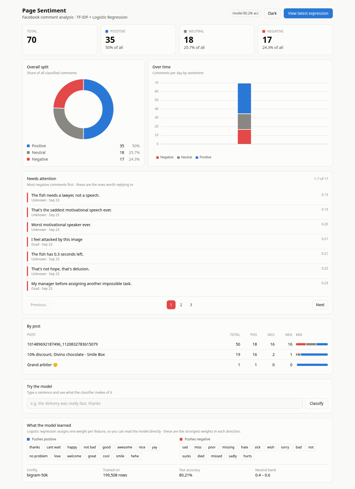
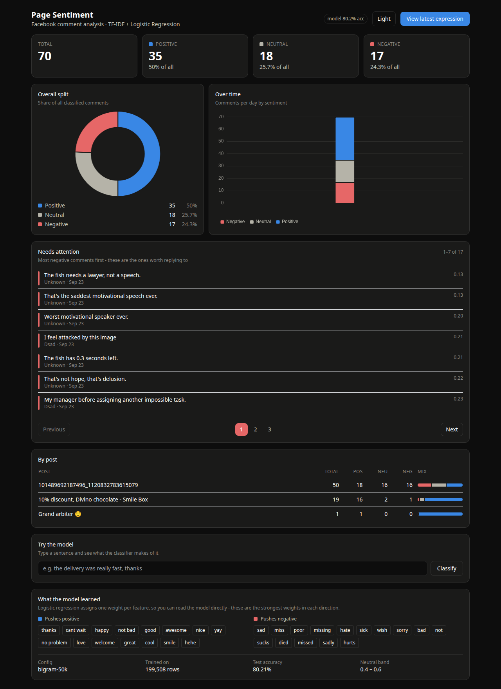

# Page Sentiment

Facebook Page comment sentiment dashboard, built on a classical ML pipeline:
**TF-IDF + Logistic Regression**, trained on Sentiment140 (1.6M tweets).

Click **View latest expression** → the app pulls the newest comments, classifies
them, and updates the charts. No background workers, no webhooks, no cron.



<details>
<summary>Dark theme</summary>



</details>

Both themes use a *diverging* colour scale — positive and negative as opposed
hues with a neutral gray midpoint — because sentiment is polarity, not identity.
The palette is validated for colourblind separation in both modes.

---

## Quick start

**1. Backend — train the model**

```bash
cd backend
uv sync                          # install dependencies
uv run python download_data.py   # fetch Sentiment140 (~81 MB, no Kaggle account)
uv run python train.py           # train + evaluate + save the model (~1 min)
uv run python app.py             # API on http://127.0.0.1:5000
```

**2. Frontend**

```bash
cd frontend
npm install
npm run dev       # dev server on http://127.0.0.1:5173, /api proxied to Flask
```

Open **http://127.0.0.1:5173** while developing — Vite gives you hot reload and
proxies `/api` to Flask, so there is one origin and no CORS to configure.

To ship it as a single service:

```bash
cd frontend && npm run build     # builds into backend/static/
cd ../backend && uv run python app.py
```

Then everything is served from **http://127.0.0.1:5000** — one process, no Node
required at runtime.

It runs on **demo data** out of the box, so you can see the whole thing working
before touching Meta's developer portal.

## Going live on your real page

```bash
cp backend/.env.example backend/.env
```

Fill in `FB_PAGE_ID` and `FB_PAGE_ACCESS_TOKEN`, then restart. Required Graph API
permissions: `pages_read_engagement`, `pages_read_user_content`, `pages_show_list`.
While your Meta app is in Development Mode you can read Pages you administer
without App Review — enough for a dashboard you use yourself.

---

## Layout

```
backend/
  download_data.py   fetch Sentiment140 from Stanford
  dataset.py         load / clean / split          <- data decisions live here
  train.py           train, compare, evaluate, save <- modelling decisions here
  predict.py         load the pipeline, classify    <- used by the web app
  facebook.py        Graph API client + demo mode
  db.py              SQLite schema and queries
  app.py             Flask API + serves the built frontend
  static/            frontend build output   (gitignored)
  data/              dataset + app.db        (gitignored)
  models/            trained artifacts       (gitignored)

frontend/
  vite.config.js     dev proxy + builds into backend/static
  src/
    App.vue          page layout and data loading
    api.js           every call to Flask lives here
    theme.js         light/dark, and the CSS-variable reader
    format.js        shared date / percent helpers
    style.css        Tailwind + the chart color tokens
    components/
      KpiTiles.vue        the four headline numbers
      SentimentDonut.vue  overall split + direct labels
      TimelineChart.vue   stacked bars per day
      TryModel.vue        type a sentence, see the prediction
      NeedsAttention.vue  most negative comments first
      PostBreakdown.vue   per-post table
      ModelInsights.vue   what the model learned
```

## Chart colors

Sentiment is **polarity**, not identity, so the charts use a *diverging* scale —
two opposed hues with a neutral gray midpoint — rather than three arbitrary
categorical colors. The tokens live in `frontend/src/style.css` and components
read them with `getComputedStyle`, so the palette is defined once.

Both themes were checked for colorblind separation. Worst adjacent pair: ΔE 8.7
light, ΔE 10.3 dark (target ≥ 8). Dark mode uses a lighter gray (`#b5b3a8`)
because the light-mode gray collapses against the dark-mode red under
protanopia (ΔE 3.9).

---

## Training

```bash
uv run python train.py                 # 200k sample (default) - fast to iterate
uv run python train.py --sample 50000  # faster still
uv run python train.py --full          # all 1.6M rows
uv run python train.py --cv 5          # add 5-fold cross-validation
```

It runs three phases:

1. **Compare** three feature configurations on the **validation** split
2. **Cross-validate** the winner (optional, `--cv`)
3. **Evaluate once** on the held-out **test** split, then save

Current result on a 200k sample: **80.2% test accuracy** — essentially matching
what the full 1.6M gives, which is why the sample default is there.

| config | features | val accuracy |
|---|---|---|
| unigram-5k | single words, stopwords removed | 0.7584 |
| bigram-10k | + two-word phrases | 0.7937 |
| bigram-50k | + larger vocabulary | **0.7984** |

---

## Things worth understanding

**Why bigrams win.** Unigrams cannot represent negation — `not` and `happy` as
separate features say nothing about `not happy`. Bigrams capture `not bad`,
`cant wait`, `no problem` as their own features. You can see this in the trained
weights: `not bad` ranks as strongly **positive** while bare `not` is strongly
negative.

**Why the bigram configs stop removing stopwords.** sklearn's English stopword
list contains `not`, `no`, `cannot`. Strip those and the negation bigrams you
just added cease to exist. Feature engineering decisions interact.

**Why a Pipeline.** The classic beginner bug is saving the classifier but not the
vectorizer, then calling `fit_transform()` on new text at prediction time — which
builds a brand-new vocabulary, so column 7 no longer means what it meant during
training. Nothing raises; accuracy just quietly collapses. A `Pipeline` makes the
mistake unexpressible.

**Why three splits.** You compare configurations on validation as often as you
like. Test is touched exactly once, at the end. Tuning against test means your
reported accuracy is no longer an estimate of real-world performance.

**Why a neutral band.** Sentiment140 is binary, so `predict()` can only say
positive or negative. But plenty of real comments carry no sentiment at all
("what's the price?"). Rather than force those into a bucket, `predict.py` reads
the *probability* and calls anything in `0.40 – 0.60` neutral. Tune the band in
`predict.py` against your own comments — it is a calibration choice, not a
trained one.

**The dataset is sorted by label.** Rows 0–799,999 are all negative. `df.head(n)`
gives you a 100% negative dataset. Always sample randomly.

---

## Known limits

- **English only.** Sentiment140 contains no Bangla. The cleaning step keeps only
  `a-z`, so Bangla-script comments clean to an empty string — `predict.py`
  detects this and returns neutral with `confidence: 0.0` rather than inventing
  an answer. Romanized Banglish survives cleaning but its vocabulary is absent
  from the model, so treat those scores as unreliable too.
- **~80% accuracy.** Sentiment140's labels were derived from emoticons rather
  than human annotation, so a portion are simply wrong. That noise is part of
  the ceiling.
- **Sarcasm and context** are not handled. No bag-of-words model does.

---

## Dataset

Sentiment140 — Go, A., Bhayani, R. & Huang, L. (2009), *Twitter Sentiment
Classification using Distant Supervision*, Stanford. 1.6M tweets auto-labelled by
the emoticon they contained; the emoticons were then **stripped from the text**
before release, so the model learns from words rather than smileys.
